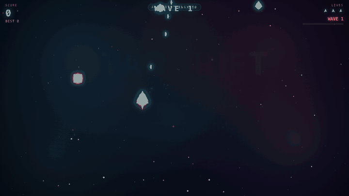

# Qwen3.8-Flash-Next on Glyd

Qwen3.8-Flash-Next (180B params, MoE) running on one 16 GB NVIDIA card + 64 GB RAM, on Linux. Uses our own engine and our own
compressed weights. Free for personal use.



That game was written by the model in one prompt on my 4080 SUPER, unedited. It doesn't work every time: 3 of 6 tries were playable in
precise mode. All 6 are in [examples/star-drift](examples/star-drift), the broken ones included.

## Why this exists

I wanted big MoE models running at home on a normal gaming PC, not a server. The usual route is a quant file plus a general-purpose
engine. I went the other way and built the compression and the engine together, so each one can assume things about the other:

- The engine knows which experts the model actually routes to. The busy ones live on the GPU, the rest stay in RAM, and the CPU computes
  those at the same time as the GPU works.
- The experts are compressed by how often they get used. Busy experts keep more bits, rarely used ones get fewer.
- The model's own small draft head guesses the next token and the big model checks it in the same pass (about 1.9 tokens per step).
- Long prompts go through the model one layer at a time, so a 32K prompt doesn't blow up memory.

More detail: [docs/HOW_IT_WORKS.md](docs/HOW_IT_WORKS.md).

This is the first big model I'm releasing on it. The same engine runs other models (Nemotron, Qwen3.8-27B and more), and Gemma 4 is
next.

## Numbers

My machine: RTX 4080 SUPER 16 GB, Ryzen 9 7950X3D, 64 GB RAM, Ubuntu 26.04.

```
                                     precise         fast
experts, avg bits/weight             ~2.7            ~2.1
attention + rest                     4-5 bit         4-5 bit
KV cache                             bf16            bf16
download                             82 GB           68 GB

chat, default sampling               117 tok/s       135 tok/s
greedy, short prompt                 145 tok/s       169-173 tok/s
read a 32K-token prompt              ~7 s            ~7 s
read a 261K-token prompt             -               66 s

GSM8K   (150 q, Inspect AI)          148/150         148/150
MMLU-Pro (150 q, Inspect AI)         124/150         118/150
one-shot game (Star Drift)           3/6 playable    1/6
```

Benchmarks were run with thinking off and greedy decoding. GSM8K is mostly a sanity check that compression didn't break reasoning.
MMLU-Pro and the one-shot game tell you more. Every question, answer and log is in [results/v0.1.0](results/v0.1.0), and the scripts
are in [bench/](bench). Also tested on a cloud A10 (24 GB): `results/v0.1.0/a10`.

To measure your own PC: `tools/bench.sh` (about 5 min). It prints a block at the end to paste into a "Bench result" issue.

## What you need

- NVIDIA RTX 30/40/50 series (or an Ampere+ workstation card) with 16 GB+ VRAM, driver 580+
- 64 GB RAM
- ~90 GB free disk (75 GB for fast mode), SSD strongly recommended
- Linux x86-64, Ubuntu 22.04+ or similar (tested on 22.04 and 24.04). No Windows yet, and WSL is untested.

## Install

```sh
git clone https://github.com/surya-koritala/glyd-condor && cd glyd-condor
./setup.sh
```

It checks your GPU/RAM/disk, installs the engine (no sudo), downloads the model (resumable, just rerun it if it stops), asks precise or
fast and how much context, then opens the app at `http://127.0.0.1:8080`. Enter takes the defaults. Run `./setup.sh` again to start it
next time; it won't download anything twice.

If you use an AI coding assistant, you can also just paste it this:
`Set up https://github.com/surya-koritala/glyd-condor on this PC - follow docs/AI_SETUP.md`

## Precise vs fast

Precise is the default and I'd use it for code: long programs come out right a lot more often. Fast is 15-20% quicker and fine for chat.
To switch: `tools/download.sh --fast` then `tools/serve.sh --fast` (drop `--fast` to go back).

## Using it

- Browser: `http://127.0.0.1:8080`. Chat (renders tables, code, diagrams, and runs the HTML/games the model writes), a live monitor of
  GPU/CPU/RAM, and an About page.
- OpenAI-compatible API: `http://127.0.0.1:8080/v1`, any key and any model name.
- Anthropic-compatible API: `http://127.0.0.1:8080/v1/messages`, e.g. `ANTHROPIC_BASE_URL=http://127.0.0.1:8080 claude`.
- Other apps and agent frameworks, and what's tested with tool calls: [docs/CLIENTS.md](docs/CLIENTS.md).
- MCP: `claude mcp add glyd -- ~/.glyd-qwen-3.8-flash/bin/glyd-engine qwenmcp --repo /path/to/glyd-condor`
- Thinking is off by default (fastest). Turn it on in chat settings or with `reasoning_effort`.
- Context up to 262,144 tokens. Follow-up messages reuse the conversation, so they start in under a second.

## Known limits

- Text only. The base model's vision part isn't supported yet.
- Linux + NVIDIA only, 16 GB minimum.
- One request at a time, and others queue.
- Fast mode is noticeably weaker on long code.
- If you don't have enough free RAM, it gets very slow and the disk gets busy. Close the browser tabs eating your RAM.

## Troubleshooting

- Download stopped: rerun `./setup.sh`.
- "No NVIDIA driver found" / "580 or newer is needed": update the driver (Ubuntu: `sudo apt install nvidia-driver-595`), reboot.
- Port 8080 in use: it's probably already running, or use `tools/serve.sh 8090`.

Anything else: open an [issue](https://github.com/surya-koritala/glyd-condor/issues) with what it printed. Security stuff goes
privately via [SECURITY.md](SECURITY.md).

## License

- Model: [Qwen3.8-Flash-Next](https://huggingface.co/Qwen/Qwen3.8-Flash-Next) by the Qwen team, under its license. The compressed
  weights on [Hugging Face](https://huggingface.co/glyd/Qwen3.8-Flash-Next-hummingbird) carry the same license.
- This repo (setup scripts, chat app, benchmarks, docs): [Apache 2.0](LICENSE).
- The engine ships compiled in [releases](https://github.com/surya-koritala/glyd-condor/releases) under
  [BUSL 1.1](ENGINE-LICENSE): free for personal, research and non-commercial use. Commercial use needs a license
  (suryakoritala@getglyd.com). Each version turns Apache 2.0 four years after release.

PRs welcome, see [CONTRIBUTING.md](CONTRIBUTING.md). Thanks to the Qwen team for open-weighting this model.
