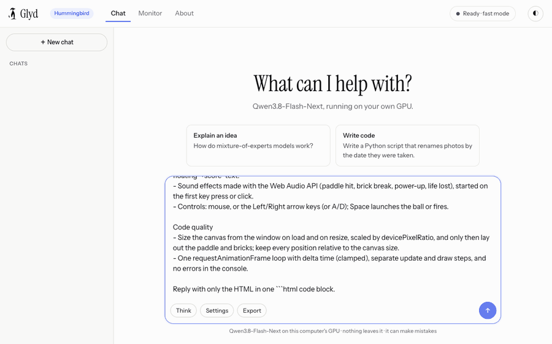
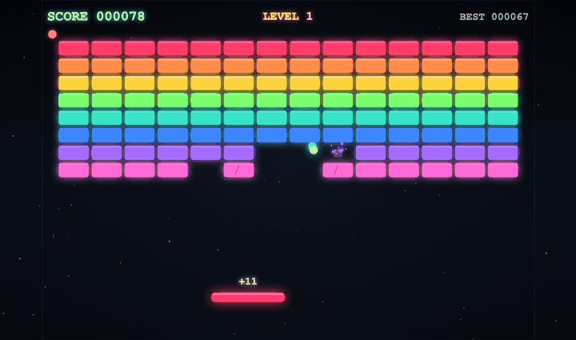

# Qwen3.8-Flash-Next on Glyd

**Qwen3.8-Flash-Next, a 180-billion-parameter model, on one 16 GB gaming GPU, faster than the leading consumer engine.**

Glyd runs Qwen3.8-Flash-Next (180B, 512 experts a layer, 336 GB in bf16) on an RTX 4080 SUPER 16 GB with 64 GB of RAM, at Glyd's
**Hummingbird** level, the most compact of its five (Penguin, Kestrel, Swift, Wren, Hummingbird).
It uses [Glyd](https://getglyd.com)'s own inference engine (Rust and CUDA) and Glyd's own expert compression. This repository holds the
scripts, the OpenAI-compatible server, the benchmarks and every result log. The engine itself ships compiled, in the
[releases](https://github.com/surya-koritala/glyd-qwen-3.8-flash/releases).



*Real time on the RTX 4080 SUPER: the chat app that comes with it, writing a full arcade game at about 150 tokens a second. Below, the
game it wrote ([examples/neon-breakout](examples/neon-breakout): the prompts, every fix round, and the file, unedited).*



## Results

All numbers are from the same PC: RTX 4080 SUPER 16 GB, Ryzen 9 7950X3D, 64 GB RAM, Ubuntu. Both engines ran there in October 2026, on
Strata's own speed prompts and question sets.

### Speed

| | Glyd fast | Glyd precise | Strata Q2_0 | Strata IQ3_XXS |
|---|--:|--:|--:|--:|
| Writing, Strata's speed prompt | **169–173 tok/s** | **145 tok/s** | 161–165 | 125–140 |
| Writing, no drafting | **104 tok/s** | | 96–100 | |
| Reading a 32,000-token prompt | **7.2 s** | | 9.6 s | |
| Writing right after a 32,919-token prompt | **135 tok/s** | | 129.5 | |
| Writing code (HumanEval replies) | 184 tok/s | 148 tok/s | | |
| Chat with the default sampling (`tools/bench.py`) | 145 tok/s | | | |

### Quality

The same harness for every row: Inspect AI, greedy, thinking off, a 3,072-token cap, and the same 150 + 150 questions as the Strata runs.
Glyd's GSM8K and MMLU-Pro rows are from a fresh install of this release (`./setup.sh`, then `bench/run_bench.sh`).

| | Glyd fast | Glyd precise | Strata Q2_0 | Strata IQ3_XXS |
|---|--:|--:|--:|--:|
| GSM8K (150) | **149** | **149** | 148 | 147 |
| MMLU-Pro (150) | 120 | 125 | not finished | **126** |
| HumanEval (164)* | 156 (95.1%) | 155 (94.5%) | | |

\* HumanEval ran on the engine before the release packaging, with the same experts.

Most MMLU-Pro misses, on both engines, are long answers still working at the 3,072-token cap (21 of fast mode's 30). Precise mode
matches Strata's best within a question. Every log is in [results/](results/) (this release's: [results/release-v0.1.0-fast](results/release-v0.1.0-fast)).

### Two modes, one level

Both are Hummingbird: about 2.1 bits per weight for fast and 2.7 for precise, on the experts.

- **Fast** (the default) uses Glyd's smallest expert format, so more experts fit in GPU memory.
- **Precise** (`tools/serve.sh --precise`) adds the precision pack, an optional 41 GB download that keeps more bits where they matter. It is about 4× closer to the original model: KL
  divergence on a 5,923-token document is 0.06, against 0.22 for fast mode.

## How it works

- **Experts where they are used.** The busiest experts stay in GPU memory and the rest in RAM. The CPU computes the experts that
  aren't on the GPU, and after a long prompt the GPU's cache refills before writing starts.
- **Compression by usage.** Glyd compresses the experts to 2 to 4 bits, with more bits where routing goes most: 336 GB of weights
  become a 39 GB pack.
- **Guess, then check.** The model's own prediction head drafts up to six tokens while it stays confident, and one pass checks them all.
- **Long prompts layer by layer.** A 32K prompt streams through the model one layer at a time, on tensor-core kernels.

## Run it

You need:
- Linux on x86-64 (Windows through WSL2), and an NVIDIA GPU with 16 GB or more (Ampere, Ada, Hopper or Blackwell), driver 580 or newer;
- 64 GB of RAM;
- about 75 GB of free disk (110 GB to add precise mode).

```sh
git clone https://github.com/surya-koritala/glyd-qwen-3.8-flash && cd glyd-qwen-3.8-flash
./setup.sh
```

`setup.sh` does the rest:
- checks your GPU, RAM and disk;
- installs the compiled engine and a small Python environment under `~/.glyd-qwen-3.8-flash` (no sudo);
- downloads the model, about 68 GB;
- asks two questions, fast or precise mode and how much context;
- opens the chat page.

Next time, `./setup.sh` starts it right away. Let an AI assistant do it: point it at [docs/AI_SETUP.md](docs/AI_SETUP.md).

### What you get

- **A chat app** at http://127.0.0.1:8080/: live streaming, rich formatting (tables, code with highlighting), flowcharts drawn as
  diagrams, a live preview for the HTML pages, games and animations it writes, an optional "think first" mode, chats kept in your
  browser, and a Monitor tab with the GPU, memory and speed live.
- **Long context**: up to 262,144 tokens (`./setup.sh` asks; a 261,577-token prompt read in 66 s on the 4080). Follow-up messages
  reuse the conversation, so turn two of a long chat starts in well under a second.
- **An OpenAI-compatible API** at `http://127.0.0.1:8080/v1`, model `qwen3.8-flash-next`: streaming, tool calls and `reasoning_content`.
  Works with Open WebUI, Continue, Cline and anything else that speaks OpenAI.
- **An Anthropic-compatible API** at `http://127.0.0.1:8080/v1/messages`: streaming and `tool_use` for tools built on Anthropic's API.
- **An MCP server**, so AI tools can start, stop and ask it:
  `claude mcp add glyd -- python3 /path/to/glyd-qwen-3.8-flash/tools/mcp_server.py`.
- **A speed test**: `tools/bench.py` measures a chat and 4K, 16K and 32K prompts on your computer and writes a report to share.
- **The benchmarks**: `bench/run_bench.sh` reruns GSM8K and MMLU-Pro against your server.

Nothing leaves your computer.

## License

- This repository (scripts, server shim, benchmarks, results, documentation) is under the Apache License 2.0 ([LICENSE](LICENSE)).
- The compiled Glyd engine in the releases is under the Business Source License 1.1 ([ENGINE-LICENSE](ENGINE-LICENSE)). It is free
  for personal, research and other non-commercial use, including on your own machines. Commercial production needs a license
  (suryakoritala@getglyd.com). Each version becomes Apache-2.0 four years after release.

The model's weights are Qwen's, under Qwen's license. Glyd's pack on Hugging Face is derived from them; neither is in this repository.
